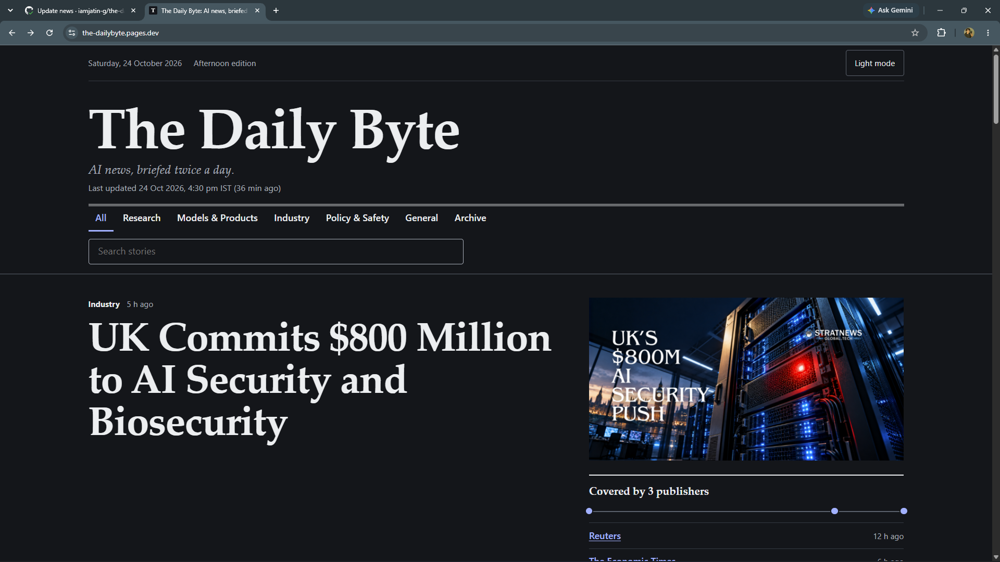
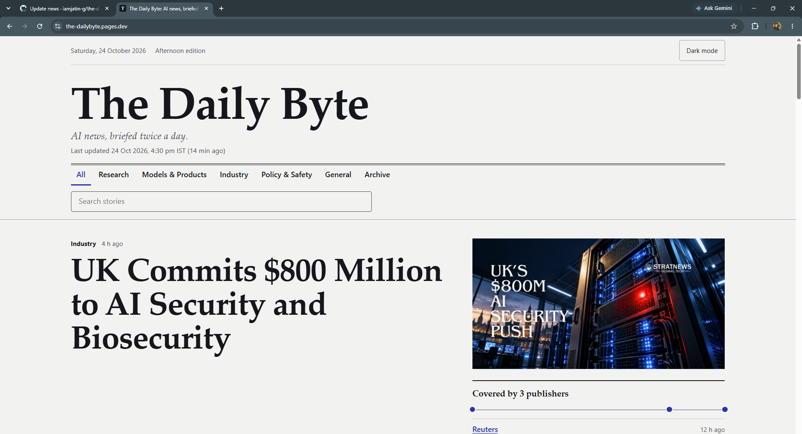
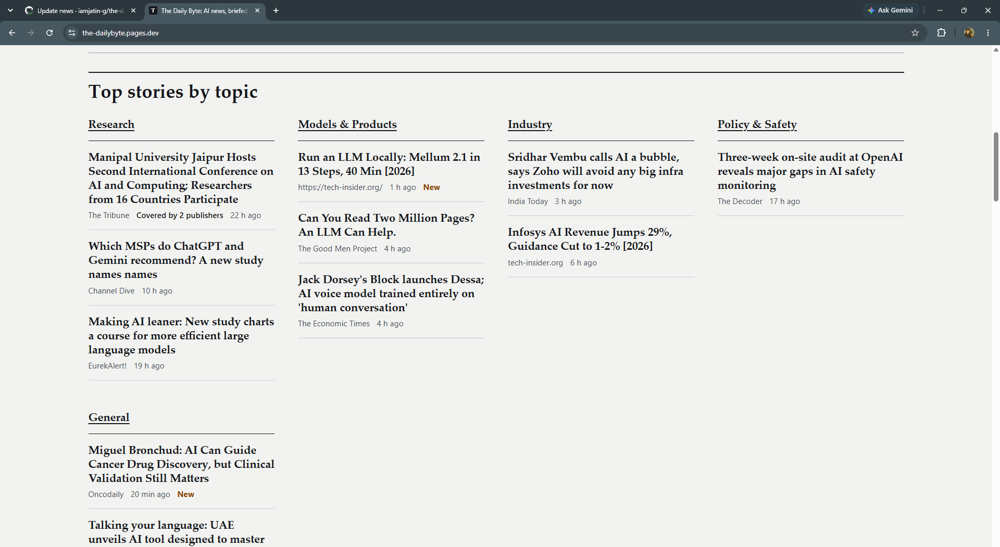
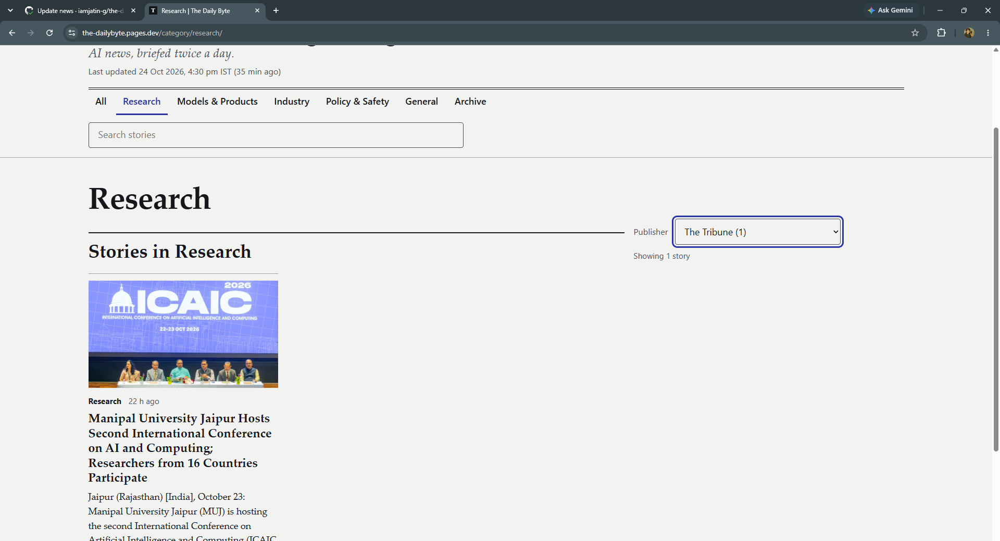
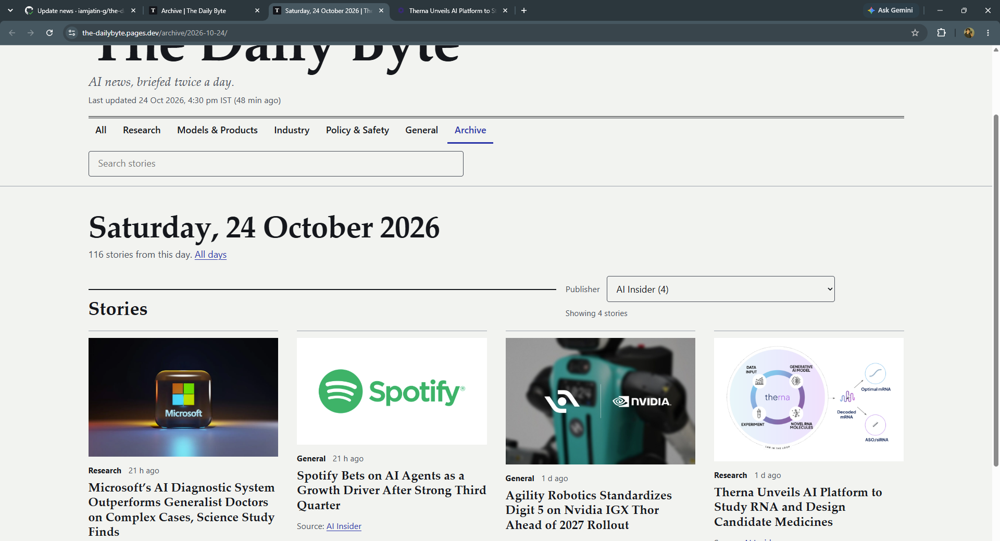
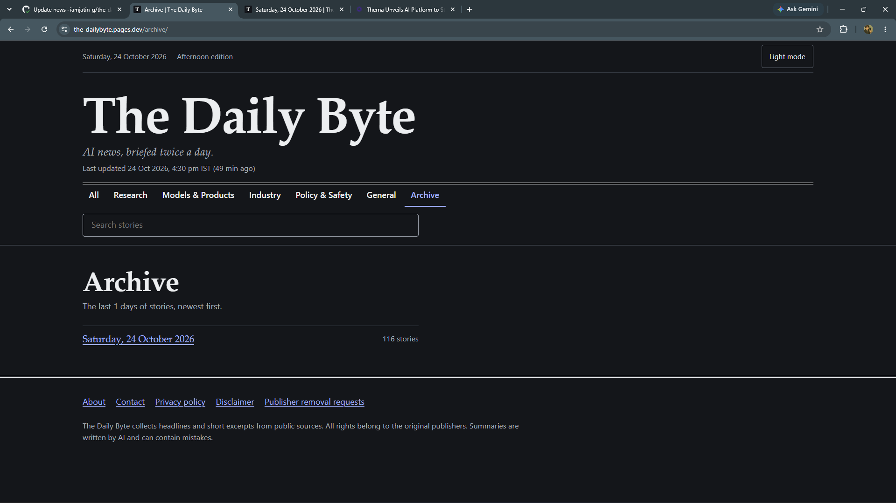
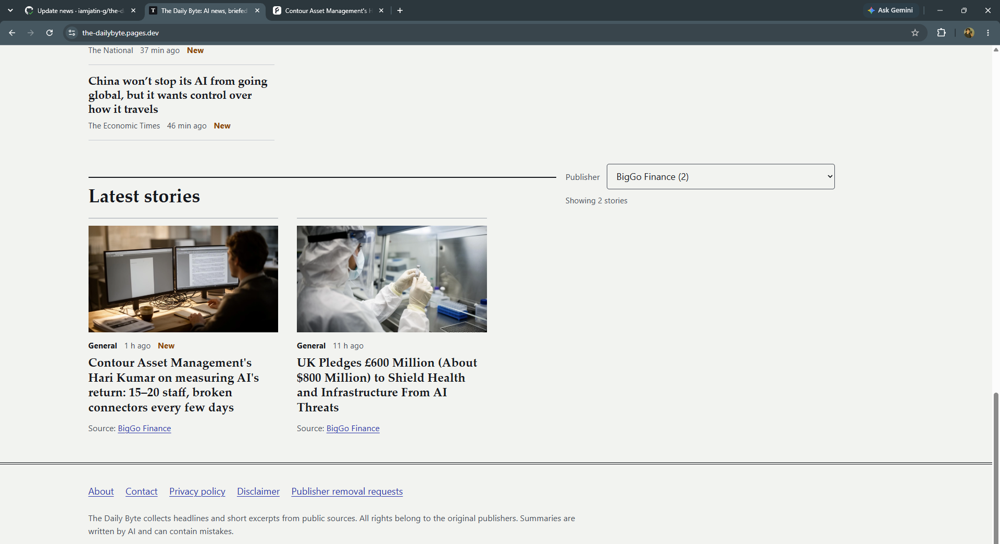
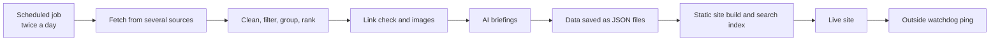

# The Daily Byte: a self-updating AI news website

**A news site that finds stories, groups and ranks them, writes short AI briefings and republishes itself twice a day, with no server, no database and no manual work.**

  <strong>Live site:</strong>
  <a href="https://the-dailybyte.pages.dev">the-dailybyte.pages.dev</a>

  <strong>Built by:</strong> Jatin Ghind
  

---

## Built With

FRONTEND & CORE

  
  
  
  

NEWS & AI

  
  
  

AUTOMATION & DEPLOYMENT

  
  
  

SEARCH, VALIDATION & QUALITY

  
  
  
  
  
  

---

## What it does

Twice a day, on its own, the system:

1. Collects news on AI and machine learning from several sources.
2. Keeps only headlines, short excerpts and links, never full articles.
3. Removes spam and duplicates, and groups the same story reported by different publishers.
4. Ranks stories by how many publishers covered them, how fresh they are and how reliable the sources are.
5. Checks that links work and finds a picture for each story.
6. Writes a short AI briefing for the top stories, with a daily limit.
7. Rebuilds and publishes the website, then sends a "still alive" signal to an outside monitor.

Nothing is added or approved by hand.

**What visitors get:** a lead story, top stories by topic, topic pages, instant search, a publisher filter, a day-by-day archive, an RSS feed, light and dark themes, and a "Covered by N publishers" badge that credits and links every source.

---

## Screenshots

|                                                                                                     |                                                          |
| --------------------------------------------------------------------------------------------------- | -------------------------------------------------------- |
|                                     |   |
| *Front page: lead story with the "coverage ledger" showing which publishers reported it and when* | *Top stories grouped by topic*                         |
|                                                      |                |
| *Latest stories with images and source credit*                                                    | *Dark mode*                                            |
|                                                         |       |
| *A topic page with the publisher filter*                                                          | *A day in the archive*                                 |
|                                             |  |
| *The archive in dark mode*                                                                        | *Publisher filter narrowing the list*                  |

---

## Why I built it

I wanted a project that goes beyond a tutorial: something that runs unattended, copes with unreliable data, and has to be trustworthy because it republishes other people's work. My goals were zero maintenance, zero cost, no database or always-on server, safe failure (a broken source must never blank the site), and fairness to publishers (short excerpts only, always link back, removal on request).

---

## Architecture

## Tech stack

| Area         | Used                                                    | Why                                                                      |
| ------------ | ------------------------------------------------------- | ------------------------------------------------------------------------ |
| Site         | Astro (static), TypeScript, Tailwind CSS                | Fast plain-HTML pages with almost no JavaScript                          |
| Data checks  | Zod                                                     | Every data file is validated, so bad data cannot silently break the site |
| Storage      | Flat JSON files                                         | No database to run or pay for                                            |
| Search       | Pagefind                                                | Search runs in the visitor's browser, no search server                   |
| Automation   | GitHub Actions                                          | Free scheduled jobs and secret storage                                   |
| Hosting      | Cloudflare Pages                                        | Free, fast, static hosting                                               |
| News sources | Google News RSS, GDELT, a news API, publisher RSS feeds | Several sources so one failing does not stop the site                    |
| AI summaries | Free-tier language models                               | Short briefings with a safe fallback                                     |
| Monitoring   | healthchecks.io                                         | Emails me if the site ever goes silent                                   |
| Quality      | Vitest, ESLint, Prettier, Dependabot                    | Tests, consistent code and update checks                                 |

---

## How it works

- **Resilient fetching:** parallel requests with timeouts, retries with backoff and polite per-site delays.
- **Sanitising:** HTML is stripped, excerpts are cut short, and only a small set of fields is ever stored.
- **De-duplication vs clustering:** the same link is a duplicate and is removed, but the same story from different publishers is real "coverage" and is grouped.
- **Explainable ranking:** a simple weighted score that is easy to reason about and debug.
- **Link and image checks:** only confirmed dead links are dropped, because many healthy sites block bots. Missing images are found from each story's page, and only the image address is stored.
- **Self-healing:** a source that keeps failing is switched off automatically and retried later.
- **Fail-safe:** if every source fails, the old content stays live and the run is marked failed, so I get an alert.

---

## Automation

One scheduled workflow does everything in order: fetch, rank, brief, save, build, deploy, then ping the monitor. It uses a time-zone conversion (India time to UTC), prevents overlapping runs, has timeouts on every step, and includes a keep-alive so GitHub never pauses the schedule. API keys live only in secret storage, never in the website code.

---

## The AI briefing layer

The model only sees headlines and short excerpts. Its answer is treated as untrusted: it must be valid and the right length, contain no links, and not copy wording from the sources. There is a daily call cap, calls are spaced out, unchanged stories reuse earlier summaries, and if the AI fails the site simply shows the publisher's excerpt. Summaries are labelled as AI-written and every source is linked.

---

## The website

Design direction: an editorial newspaper look with a large serif masthead. A distinctive feature is the **coverage ledger**, which lists every publisher that reported the lead story in the order they did.

- Works from small phones to 4K screens with no sideways scrolling and no layout jumps.
- Light and dark themes with no flash on load.
- Accessible: skip link, visible keyboard focus, large touch targets, and text contrast tested against WCAG AA.
- Still readable with JavaScript turned off.
- Page text is escaped to prevent injection, and outgoing links open safely in a new tab.

---

## Testing

Automated tests run on saved sample data (no internet needed) and cover parsing, filtering, de-duplication, clustering, ranking, link checks, the AI layer, the "all sources failed" path and an end-to-end dry run. I also checked the pages in a real browser at several screen sizes, and I deliberately broke the code in places to confirm the tests fail when they should.

I have not published Lighthouse scores yet.

---

## How I built it

I built this with **AI assistance (Claude by Anthropic) as a pair programmer**. I set the requirements and design direction, chose the data sources and limits, set up the accounts and deployment, ran it on the real internet, and debugged what broke. The AI wrote most of the first code; I learnt the system by running, breaking and fixing it.

---

## Problems I hit and how I solved them

| Problem                                                                          | Fix                                                                                        |
| -------------------------------------------------------------------------------- | ------------------------------------------------------------------------------------------ |
| Install failed because I had pinned a package version that does not exist        | Used a real version and learnt to verify pinned versions                                   |
| The worker crashed on an unexpected data shape from one feed                     | Made text cleaning accept any input and made one bad item skip instead of stopping the run |
| A news source was switched off by the self-healing logic after repeated timeouts | Raised the timeout and reset the stored health state                                       |
| AI summaries failed when the free model was busy                                 | Confirmed the fallback works and treated free-tier AI as unreliable by design              |
| Every story had no image                                                         | Added a page-level image lookup and a second news source that returns images               |
| A topic page was empty while the front page showed stories                       | Fixed how topic pages gather stories                                                       |
| Dependabot suggested major version upgrades that would break the build           | Reviewed them, closed the risky ones and limited future suggestions                        |

---

## What I learnt

- **Serverless design:** a scheduled job writes files, a build turns them into pages, and a CDN serves them. A fail-safe matters more than features.
- **Monitoring unattended systems:** self-healing and an outside "dead man's switch" so silence raises an alert.
- **Messy real-world data:** validate every field, and treat duplicates and coverage as different problems.
- **Responsible web use:** respecting robots.txt and rate limits, keeping only short metadata, and why APIs are better than scraping.
- **AI in production:** treat model output as untrusted input, defend against prompt injection, cap usage and always have a non-AI fallback.
- **CI/CD:** cron in UTC, secrets, concurrency, timeouts, reading logs to diagnose failures, and handling dependency updates carefully.
- **Frontend quality:** accessibility, no layout shift, progressive enhancement and no-flash theming.
- **Working with AI tools:** specify precisely, verify instead of trusting, and give exact error messages to get good fixes.

---

## Limitations and next ideas

- Free sources return fewer stories than paid ones, and some stories have no image.
- AI summaries can be wrong, which is why they are labelled and sourced.
- Ideas for later: Telegram posting, an email digest, story threads across days, and Hindi and Marathi translation.

---

## Credits

News data comes from public sources and publishers' own feeds. All headlines, excerpts and images belong to their original publishers.
